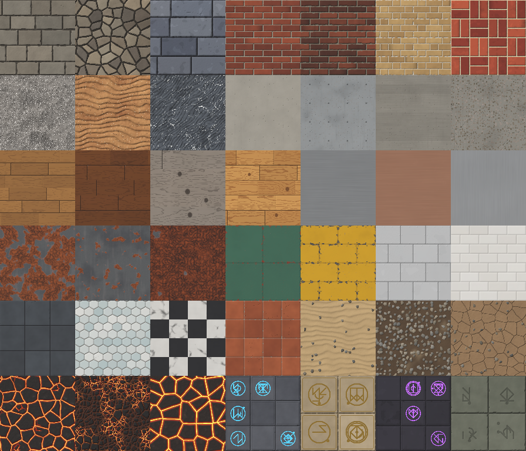

# Material Foundry

A browser-based studio for creating **tileable procedural game materials** and exporting real PBR texture maps.
Pick a preset, see it on a sphere, wall, floor, block or small scene, adjust understandable controls, compare
variations, and export Base Color, Normal, Roughness, Metallic, Height, AO, Emissive and a packed ORM texture.

Everything runs locally in the browser: no accounts, API keys, paid services, servers or downloaded texture packs.
Materials are generated by deterministic, seeded mathematics (periodic noise, Voronoi, signed distance functions and
structured layouts) in Web Workers.



## Quick start

Requirements: Node.js 20+ (tested with Node 22.22) and npm 10.

```bash
cd material-foundry
npm ci                # install the locked dependency versions
npm run dev           # development server with hot reload -> http://localhost:5173
```

Production build and local preview:

```bash
npm run build         # type-check (tsc -b) + Vite production build into dist/
npm run preview       # serve dist/ -> http://localhost:4173
```

`dist/` is a fully static site (relative asset paths). It can be opened from any static file server; it needs no
network access after loading. (It must be served over http(s), not opened as `file://`, because it uses module
Web Workers.)

Other scripts:

| Command | What it does |
| --- | --- |
| `npm test` | Unit tests (Vitest, Node): periodicity, determinism, normals, PNG/ZIP, schema, state |
| `npm run e2e` | Browser end-to-end verification (Playwright + Chromium) of the real UI; requires `npm run build` first. Writes `verification/` |
| `npm run e2e:4096` | Browser check of a full 4096 ZIP export (slow); writes `verification/e2e-4096.json` |
| `npm run examples` | Regenerates the example ZIP exports and contact sheet in `examples/` |
| `npx tsx scripts/render-families.ts <dir> [size] [filter]` | Developer contact sheets of every preset's maps |
| `npm run typecheck` | TypeScript check only |

## Using the app

1. **Pick a preset** in the library (left). 42 presets across 12 families, each with a real generated thumbnail.
2. **Preview** it on a sphere, wall, floor, bevelled block or a wall-and-floor scene (toolbar above the view).
   Orbit with the left mouse button, zoom with the wheel, pan with the right button. *Lighting* offers studio,
   sunlight, overcast and dusk presets, light direction/elevation/intensity, preview tile size and optional
   displacement. A 1 m striped ruler and the object dimensions are shown for scale.
3. **Adjust** the material on the right: colors, pattern & structure, surface (including *Stylized ↔ Natural*),
   wear & damage and emission. Controls that do not apply are hidden. Seed: type it, *Randomize*, or *lock* it so
   presets and variations keep it. *Reset to preset*, *Undo* / *Redo* (Ctrl+Z / Ctrl+Shift+Z) are available.
4. **Compare** with *4 Variations* below the preview: same family and essential settings, new seeds plus small
   bounded changes to non-essential parameters. Clicking one applies exactly that configuration.
5. **Inspect** maps in the *Map Inspector*: switch maps, zoom (wheel), pan (drag), *Fit*, 400 %, a texel readout,
   and a *3×3 tiling* view for seam checks. *Export map* downloads the viewed map.
6. **Export** (top right): resolution 256–4096, OpenGL or DirectX normals, 16- or 8-bit height, optional ORM.
   Download a ZIP of all maps, individual PNGs, settings JSON, or a PNG of the 3D preview.
   *Import settings* (top bar) loads a previously exported settings JSON.
7. **Save favorite** stores the current material in this browser; the *Favorites* tab lists them.

## Material library

| Family | Highlights | Presets |
| --- | --- | --- |
| Stone Block Wall | ashlar courses or Voronoi rubble, recessed mortar, chips, cracks, dirt | Castle Ashlar, Fieldstone Rubble, Stylized Dungeon Blocks |
| Brick Wall | running / stack / English / Flemish / basket-weave bonds, mortar depth, worn edges, flashed bricks, grime | Red Brick Running Bond, Weathered Old Brick, Buff Brick Flemish Bond, Stylized Basket Weave |
| Rough Rock | warped ridged/fractal forms, terraced strata, mineral veins, specks | Granite Outcrop, Layered Sandstone, Slate with Quartz Veins |
| Concrete | pores and bug holes, exposed aggregate, stains and streaks, cracks, formwork panels with tie holes or board marks | Poured Concrete, Brutalist Formwork, Board-Formed Concrete, Cracked Old Slab |
| Wood Planks | flat-sawn growth rings with cathedral figure, knots with grain flowing around them, seams, oiled / varnished / weathered | Oak Floorboards, Varnished Walnut, Weathered Barn Planks, Stylized Pine Deck |
| Brushed Metal | directional brushing, scratches, smudged roughness; metallic everywhere | Brushed Stainless Steel, Brushed Copper, Satin Aluminium (Vertical) |
| Rusted Metal | corrosion patches (dielectric rust vs. metallic steel), flaking plates, pitting, run-off streaks, mill scale | Corroded Steel Plate, Light Surface Rust, Shipwreck Hull |
| Painted Metal Panels | seams, rivets or hex bolts, edge wear exposing primer then bare metal, scratches, grime | Military Green Panels, Industrial Yellow Plates, Sci-Fi Hull Plating |
| Ceramic & Stone Tiles | grid / offset / hexagon / checker layouts, grout, bevels, glazed / matte stone / marble finishes, chips & cracks | White Subway Tiles, Slate Floor Tiles, Hexagon Mosaic, Marble Checker Floor, Cracked Terracotta |
| Sand & Earth | broad variation, asymmetric wind ripples, grains, buried pebbles, damp patches, dry mud cracks | Desert Ripples, Riverbank Gravel, Cracked Dry Mud |
| Lava / Emissive Rock | raised dark crust plates, glowing molten material only in recessed cracks, heat variation | Molten Lava Crust, Cooling Magma Veins, Stylized Ember Rock |
| Arcane Stone | carved slabs with original procedurally constructed glyphs (strokes on a 3×3 lattice, arcs, rings, dots); glowing, metal or plain inlays | Glowing Rune Slabs, Gilded Temple Stone, Void Sigils, Ancient Carved Stone |

**Stylized ↔ Natural** changes the actual generation: the stylized end snaps color variation to a few palette
tones, widens and cleans bevels, reduces edge irregularity and drops the high-frequency noise octaves; the natural
end uses continuous variation, irregular edges and full fine detail.

## Texture maps and conventions

| Map | Format | Color space | Notes |
| --- | --- | --- | --- |
| Base Color | 8-bit RGB PNG (sRGB chunk) | sRGB color | No lighting or preview light direction baked in |
| Normal | 8-bit RGB PNG | non-color | Tangent space, derived from height with periodic central differences. OpenGL (Y+, green up) or DirectX (green inverted) |
| Roughness | 8-bit gray PNG | non-color | Material-driven (e.g. rust rougher than steel, varnish glossier than raw wood) |
| Metallic | 8-bit gray PNG | non-color | 1 only where bare metal is exposed; paint, rust, stone and wood are 0 |
| Height | **16-bit** gray PNG (or 8-bit on request) | non-color | 0 = deepest, 65535 = highest. True 16-bit samples (verified by tests) |
| AO | 8-bit gray PNG | non-color | **Height-based approximation** (multi-radius cavity estimate), not ray traced |
| Emissive | 8-bit RGB PNG | sRGB color | Only for emitting materials; unit-strength color, suggested strength in README/settings |
| ORM | 8-bit RGB PNG | non-color | R = AO, G = Roughness, B = Metallic |

File names: `stone_wall_seed_1042_basecolor_2048.png`, `stone_wall_seed_1042_normal_opengl_2048.png`,
`stone_wall_seed_1042_height_16bit_2048.png`, … The ZIP adds `settings.json` and a `README.txt` that documents each
map, the normal convention, resolution, seed, all settings, suggested PBR hookups (Blender, Unreal, Unity, Godot),
the AO approximation and precision limits.

In the 3D preview, base color and emissive textures use `SRGBColorSpace`; normal, ORM (AO/roughness/metallic) and
height use `NoColorSpace`. The preview always uses OpenGL normals internally (three.js convention); the
OpenGL/DirectX switch only affects exports and the inspector, by inverting the green channel.

Exports are always **regenerated natively at the chosen resolution** – never upscaled. Fine noise octaves above the
Nyquist limit of a resolution are skipped, so higher resolutions contain additional fine detail.

## Architecture

```
src/
  engine/            Pure TypeScript, no DOM. Runs in workers, the main thread and Node.
    hash.ts            Integer hashing, seeded PRNG
    noise.ts           Periodic gradient/value noise, fBm, ridged, billow, periodic Voronoi with exact edges
    patterns.ts        Periodic layouts (brick bonds, ashlar, planks, tiles incl. hex, panels), cracks, scratches
    fields.ts          Field storage (albedo, height, roughness, metal, emissive) and the generation context
    families/*.ts      One generator per material family + shared helpers (style, bevels, roughness bias)
    registry.ts        Family list, parameter definitions, validation/coercion
    presets.ts         42 curated presets
    generate.ts        Pipeline: field bands -> assembly -> normals + AO -> 8/16-bit packing
    maps.ts            Periodic normal derivation, periodic blurs, height-based AO, packing, convention switch
    schema.ts          Versioned settings JSON (format "material-foundry-settings", schemaVersion 1)
    variations.ts      Bounded variation generator
    swatch.ts          Lit 2D swatch for thumbnails / no-WebGL fallback (preview only, never exported)
  export/
    png.ts             Lossless PNG encoder (8-bit gray/RGB/RGBA, 16-bit gray) on fflate zlib
    exporter.ts        File names, per-map encoding, ORM packing, README text, ZIP assembly
  worker/
    gen.worker.ts      Executes one small task: a row band, map derivation, thumbnail, PNG encode or ZIP
    pool.ts            Priority worker pool with job tokens (cancel queued tasks; hard-cancel exports)
    client.ts          High-level API: parallel generation, thumbnails, parallel PNG encoding, ZIP
  preview/
    geometry.ts        Procedural preview meshes with metre-based UVs, closed-surface tile snapping, ruler
    renderer.ts        three.js renderer, lighting presets, textures, displacement, explicit disposal
  state/
    store.ts           Zustand store: settings, undo/redo, versioned results, prefs, favorites, toasts
    useGeneration.ts   Debounced, cancelling preview generation (fast 256 px draft, then working resolution)
    exportController.ts Export jobs, caching of the export-resolution material, downloads
    persistence.ts     localStorage (settings, prefs, favorites only) with validation and recovery
    thumbs.ts          In-memory thumbnail cache
  ui/                React components (TopBar, Library, Viewport, Inspector, Controls, Variations, ExportDialog)
```

Key design points for future development:

* **Periodicity by construction.** Every spatial function is defined on the unit square with integer frequencies and
  wrapped lattice/cell indices, so `f(u+1, v) = f(u, v)`. Domain warps add periodic offsets. Cells (bricks, planks,
  knots, rivets, glyphs) take their identity from wrapped indices, so features crossing the boundary continue on the
  other side. Neighbourhood operations (normals, blurs for AO) use toroidal indexing. Nothing is blended at the edges.
* **Resolution independence.** Generators work in UV units; widths and depths are expressed in tile fractions; normal
  slopes use `depth × N/2` scaling. The preview and the export are the same functions sampled at different sizes.
* **Adding a family:** create `src/engine/families/<name>.ts` exporting a `FamilyDefinition` (params with groups,
  `emits`, `variationKeys`, `generate(ctx, params, fields)` looping over `ctx.y0..ctx.y1` and computing
  `u = (x + 0.5) / N + ctx.offsetU`), register it in `registry.ts`, and add presets. The unit tests automatically
  cover periodicity (roll test), determinism, distinctness and band equivalence for every preset.
* **Stale results** cannot be displayed: each settings change increments a version; results are accepted only for
  the current version, and drafts never replace a full result of the same version.
* **Parallelism:** field generation is split into 32-row bands across `hardwareConcurrency − 1` workers (2–6).
  Exports run at background priority so interactive previews stay responsive; cancelling an export terminates and
  replaces the workers running it.

## Verification

See [VERIFICATION.md](VERIFICATION.md) for the commands that were run and their results, and `verification/` for the
end-to-end report, screenshots and downloaded exports.

## Limitations

* **AO** is a height-field cavity approximation; it cannot capture overhangs or occlusion from geometry outside the
  texture.
* **8-bit maps:** normal, roughness, metallic and AO are 8-bit. Height is 16-bit by default.
* **4096 exports** work (verified: 66 s in the test container, ~1.25 GB peak for single-threaded generation) but
  are slow and memory-heavy; 2048 is the recommended maximum on ordinary machines.
* **Preview UV seams are mesh seams, not texture seams.** The sphere has a meridian seam and pole pinching; the tile
  count around the sphere and column is snapped to a whole number so the texture stays continuous across the seam,
  at the cost of slight horizontal stretch for some tile sizes. Bevelled block faces have separate UV islands, so the
  pattern changes direction at block edges; with displacement enabled, hard UV seams on the block can open small
  gaps.
* **Displacement** in the preview depends on mesh subdivision (sphere 384×192, walls/floors 400×300/400×400
  segments, block 48 segments per edge) and uses 8-bit height for the GPU; exported height is 16-bit.
* **Brushed metal** uses isotropic GGX in the preview (three.js `MeshStandardMaterial`); anisotropic highlights
  are represented only through the directional normal/roughness detail.
* The 3D preview requires WebGL 2. Without it, a lit 2D swatch, the Map Inspector and all exports remain available.
* Generation speed depends on CPU cores. In the 4-core, GPU-less test container a 512 px preview took roughly
  0.7–2 s and a complete 2048 px ZIP export about 15 s; a fast 256 px draft is shown first while editing.
* While a slider is being dragged continuously, the preview updates when the movement pauses (results for outdated
  settings are deliberately discarded rather than shown).
